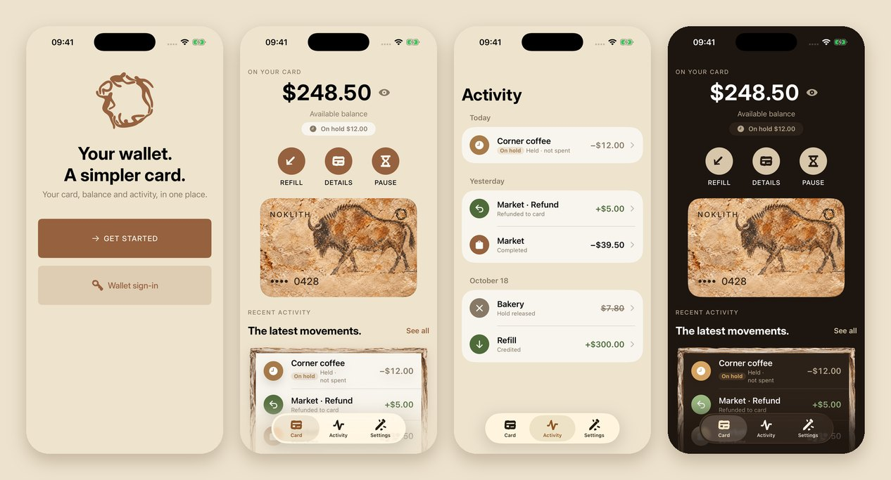

<div align="center">


<h1>Noklith</h1>

**A virtual Visa card you refill from your own crypto wallet.**

[Website](https://noklith.com) &nbsp;·&nbsp; [Dashboard](https://noklith.com/dashboard.html) &nbsp;·&nbsp; [How refills work](docs/funding.md) &nbsp;·&nbsp; [Money rules](docs/money.md)

<br>


</div>

<br>



<br>

<table>
<tr>
<td width="33%" valign="top">

### Your wallet is the login
Connect a wallet and sign one SIWE message bound to `noklith.com`. Connecting alone is not a sign-in, and the app never asks for a private key.

</td>
<td width="33%" valign="top">

### Refill in stablecoins
USDT or USDC on Polygon or BNB Smart Chain. The server checks the transfer on chain before the card is loaded, exactly once.

</td>
<td width="33%" valign="top">

### Spend anywhere online
A virtual Visa issued through IZIPAY Business. The issuer's balance is the truth; purchases and refunds show up on their own.

</td>
</tr>
</table>

## How a refill works

```
 you choose amount, network, coin
        │
        ▼
 server quotes fixed terms ──► refused up front if the issuer balance can't cover it
        │
        ▼
 your wallet sends exactly that transfer   (the app never builds or signs it for you)
        │
        ▼
 server verifies on chain: token · sender · recipient · amount · confirmations
        │                                   (32 on Polygon, 15 on BNB Smart Chain)
        ▼
 card is loaded once ──► retries and restarts never credit twice
```

> **Status.** noklith.com currently runs on the Base Sepolia test network with the IZIPAY sandbox. Polygon and
> BNB Smart Chain are implemented and switched on once the issuer balance is funded. `GET https://api.noklith.com/version`
> shows the exact commit that is deployed.

Real networks are off by default. The server accepts them only with `NETWORK_MODE=mainnet`,
`MAINNET_ENABLED=true` and a live IZIPAY key; otherwise it runs on Base Sepolia test USDC.

IZIPAY has no freeze operation, so IZIPAY cards are not paused from the app, and purchases are authorized at
IZIPAY rather than by our spend limits. See [funding](docs/funding.md#card-ownership).

## Principles

| | |
|---|---|
| **Money is never a float** | Dollars in whole cents, tokens in their smallest units, both sent as strings. Balances change only through the ledger. |
| **The issuer is the source of truth** | If the IZIPAY balance differs from ours, the difference is recorded as a purchase or refund, never overwritten silently. |
| **No keys in the app or the repo** | Signing happens only in your wallet. Configuration comes from environment variables (`apps/api/.env.example`). |

## Repository

| Path | Contents |
|---|---|
| [`apps/web`](apps/web) | Website and account dashboard, served from `apps/web/dist` |
| [`apps/ios`](apps/ios) | SwiftUI app, unit and UI tests, committed Xcode project |
| [`apps/api`](apps/api) | Fastify API on PostgreSQL, migrations and tests |
| [`packages/api-contracts`](packages/api-contracts) | Request and response shapes shared by the app, the site and the API |
| [`deploy`](deploy) | Caddy and Docker Compose setup |
| [`docs`](docs) | API, sign-in, refills, money rules and build notes |

## Development

Requires Node 24 and Python 3.

```bash
cd apps/api
npm ci
npm run check          # type check
npm test               # API tests
npm run dev:fixture    # local API with sample data on http://127.0.0.1:3000
```

The iOS app builds in CI on macOS (`codemagic.yaml`). After adding Swift files, regenerate the
project with `python scripts/dev/generate_xcode_project.py`.
